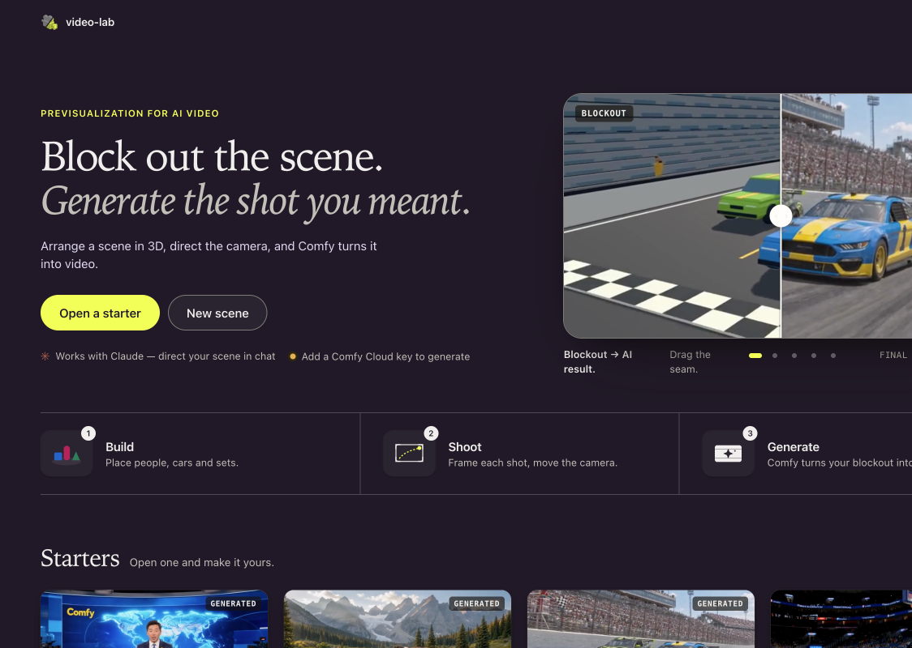

<p align="center">
  
</p>

# video-lab

A local 3D previs workspace for independent creators: build a scene, frame shots,
make blockout clips, compare video takes and export a silent film or editable project.
AI image/video generation is optional and requires a configured provider.

**Preview software.** Local save/reopen, starter-media export and a short hardware
capture path have verification evidence; full interactive acceptance is still pending.
Masked editing has known recovery/concurrent-edit risks and is excluded from the
current review. [Version and test limits](docs/review-version.md) · [Status](docs/status.md)



Captured from the local app on November 7 with bundled examples and paid generation disabled.
[Media provenance and branding limits](docs/media/README.md).

## Quick start

You need **Node.js 22.12+**, **pnpm 10.18.0**, **FFmpeg and FFprobe on PATH**, and a
browser with hardware WebGL. FFmpeg is required by the startup check even for editing.
macOS arm64 is the exercised platform; Windows/Linux and the minimum Node version
remain unqualified. Install missing prerequisites yourself before continuing.

In a terminal, in the parent folder where you want the checkout:

```sh
git clone https://github.com/sbobyn/video-lab.git
cd video-lab
pnpm install --frozen-lockfile
pnpm build
pnpm run doctor
pnpm start
```

Open **http://127.0.0.1:5190**. Keep the terminal running; Ctrl-C stops your instance.
Doctor reports missing requirements and optional providers, not complete workflow
qualification. If the port is occupied, choose a free `PORT` value before doctor/start;
do not stop another app. See [advanced setup](docs/setup.md).

No API key is needed for scene editing, bundled media, local blockouts or film export.
Paid generation defaults off. No providers/models are installed automatically.

**Already have the review archive?** Extract it into a new folder you choose, skip
`git clone`, change into the extracted folder and use its own README. The immutable
`0.1.0-review.20261106.1` package and these later local documentation edits are different
snapshots. This branch carries the follow-up documentation; use the archive’s own
README when testing that frozen version.

## Your first useful result

Open **Mountain Trail**, rename the scene, move a prop and adjust a shot camera.
Reload to confirm your edits. Make a short blockout, then in **Cut** choose the clip
and **Export film**. Open the MP4 in your player and export a `.previs.zip` to reopen
an editable copy. Allow about 20–25 minutes; follow the [hands-on guide](docs/first-use.md)
for controls, expected results and limitations.

Starters contain a mix of blockouts and previously generated media. Playing those
clips is not a new AI run; changed blocking requires recapture. Film export needs
an existing clip, uses hard cuts and currently has **no sound**. Dry-run generation
plans are not generated output. [Starter inventory](examples/starters/README.md)

## Providers, API keys and costs

Use **Setup** to check what is configured. Secrets belong in private `.env` or the
server environment; never put them in browser settings, projects or bug reports.
Copy `.env.example` only if `.env` does not already exist, edit it locally, then
restart with the same **`pnpm start`** command. Shell variables override `.env`.

Cloud needs `COMFY_CLOUD_API_KEY`; paid work also needs deliberate
`PREVIS_ALLOW_PAID=1` and request approval. Review the quote and account/project caps
before dispatch: selected prompts/media go to the provider and estimates are not
billing guarantees. MCP clients can approve within a supplied budget without another
UI confirmation. Local ComfyUI needs separately installed compatible models/nodes;
partner nodes may still cost money. No paid generation was used to qualify this review.

Setup currently explains environment configuration; persistent provider-settings
editing is **planned**, not implemented. [Configuration ownership](docs/setup.md#configuration-ownership)
· [Provider setup, spending controls and model reference](docs/providers.md)

## Your data

By default, projects/media/jobs live in **`.previs/` in the checkout**, shared assets
in **`.previs/library/`**, and the ledger in **`.previs/budget/`**. To keep data outside
replaceable source files, set `PREVIS_DATA_DIR` to your chosen writable folder before
starting; optional library/budget overrides select separate stores. Changing a path
does not move data. Never run two writers against the same stores.

Scene ZIPs preserve editable scenes and media; shared-asset ZIPs are separate, and
MP4 is only the finished film. Theme/layout preferences live in the browser and may
change with port/profile. [Backup, restore and store coverage](docs/setup.md#backup-and-restore-a-copy)

## Updates

For an ordinary Git checkout, stop your server, preserve a backup of data/configuration
and review the incoming version's changes. From the checkout:

```sh
git pull --ff-only
pnpm install --frozen-lockfile
pnpm build
pnpm start
```

Ignored `.env` and `.previs/` are not replaced by these Git commands, but that is not
a data-migration guarantee. Test a new version against a copy of valuable data first.
If Git reports local changes or a conflict, stop rather than discarding them.
Archive installs update by choosing a new separate version, not by running `git pull`.
No automatic update/sync is installed. [Rollback and exceptional updates](docs/setup.md#git-update-exceptions)

## Workflows and support

- [Hands-on walkthrough](docs/first-use.md) and [full Director guide](docs/director.md): build, cast, camera, capture, take review and cut.
- [Assets and rigged imports](docs/import.md), [shared library](docs/director.md#library-reuse-objects-across-projects), [Blender import](docs/blender-import.md).
- [Looks and variants](docs/look-presets.md), [regeneration](docs/regeneration.md), [model inputs and costs](docs/providers.md#models-and-costs).
- [Phone](docs/director-phone.md), [gamepad](docs/gamepad.md), [MCP agent setup](docs/agent-setup.md). These integrations need their own setup and qualification.
- [Report a problem](docs/reporting.md): review/redact copied diagnostics before sharing. [GitHub issues](https://github.com/sbobyn/video-lab/issues).
- [Architecture](docs/status.md#maintained-architecture-and-repo-map), [onboarding plan](docs/onboarding.md), [Linear project](https://linear.app/sbobyn/project/video-lab-e5d16e6a9ac6).

The [public demo](https://sbobyn.github.io/video-lab/) is read-only; its renamed Pages
deployment remains unqualified. Use the local app for this review.

## Development

`pnpm check` runs typecheck and both builds; `pnpm test` runs the full Node suite.
The app uses Vite/Three.js in `src/`, Node in `server/previs/`, shared scene contracts
in `shared/`. See [verification evidence](docs/review-version.md) for what was actually
run and which tests use synthetic fixtures.

## License

[MIT](LICENSE) · Copyright © 2026 Steven Bobyn.
Built with Three.js, Vite, Node and ComfyUI integrations. See [third-party notices](THIRD_PARTY_NOTICES.md).
Imported assets and provider/model services have their own terms.
