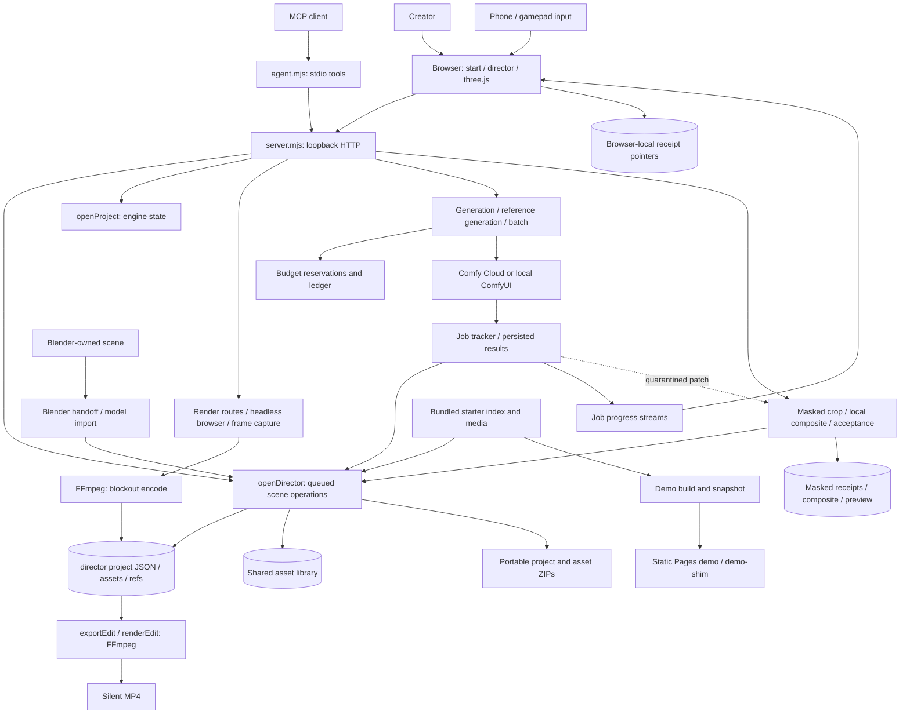

# Video Lab status

Baseline commit with limited verification; repository version `0.1.0-review.20261106.2` adds the review documentation follow-up. See [0.1.0-review.20261106.1](review-version.md) for the exact local package and fresh-install evidence. The cleanup record below remains dated baseline evidence, not the current package verification record.

Canonical repository: https://github.com/sbobyn/video-lab (one origin).
Local checkout: `~/dev/video-lab`.
Tracking: https://linear.app/sbobyn/project/video-lab-e5d16e6a9ac6

## Local release ownership — standing instruction (2026-11-06)

Steven owns `~/releases` as his personal download/install area, separate from `~/dev` and agent worktrees. Do not create, install, copy, move, modify or update anything there, including documentation, manifests, symlinks, launchers, build output or automatic sync. Installed versions change only when Steven explicitly chooses an update; an exact-version release proposal is not installation authorization. Continue development and review sessions outside that directory. This restriction remains in force until Steven explicitly authorizes a specific change.

## Cleanup disposition

Branding and single-repository publishing are integrated. Publishing preserves Git history and requires an explicit invocation; cleanup does not deploy Pages or regenerate films.

All 86 recovery copies remain untouched in the private recovery directory. A private local backup includes Git objects/refs, uncommitted files, project data, configuration and evidence; only rebuildable dependency/build directories were excluded. It was verified against source files. This is not an off-device disaster-recovery backup.

Seven dirty recovery copies were individually classified:
- genreliability: helpers already integrated; residual backend/generation/refgen differences deferred.
- mobile: camera/gestures/sheet largely integrated; residual navigation/layout differences deferred.
- operate: superseded early director/camera implementation; unmatched fragments retained, not restored over newer code.
- phone: superseded early phone/director implementation; unmatched fragments retained; hardware qualification deferred.
- principles: unique author/cast/12-principles starter expansion deferred.
- report: reporting mostly integrated; residual home/README/test differences deferred.
- w4: guide mostly integrated; historical media variants and residual guide-test differences retained.

208 file-change occurrences were inventoried; 85 match main exactly. A different older blob is not automatically a desirable patch. Details: STE-3093.

Deferred branch work: quality/Finish (five commits, tip 10a7ec4), brand restrictions (1bb321d), animation principles (5656ed5). Eagle d4eb274 is patch-equivalent to main. Historical branch refs remain under refs/archive/cleanup/ and in the backup. No recovery directories are deleted.

## PR and feature boundaries

Draft PR #1 (30b5ec8) remains unmerged. Its server resume/status/review-media endpoints were ported to main with the two recovery fixes (later-completed saved job after an uncertain receipt; verified local preview retry) on top of the queued acceptance from PR #4; PR #1's Director UI (resume/reopen panel and styles) is not on main. STE-3092 tracks qualification. Do not describe the complete post-Cloud review/accept journey as qualified.

Archived three-vcam PR #6 has the same head and is superseded by #1. The predecessor is closed; its repository remains archived.

Starter provenance (STE-3089, partial, 2026-11-09): population reconciled by id, not count. The 29 ids in [library-blockouts.json](../scripts/blender/library-blockouts.json) (recipe sha256 `ecd44866…a39eb5`) are all among the 32 manifest ids; the other three (eagle, elk, terrain) are Blender-built by `generate-blockouts.py`. [library-blockouts.provenance.json](../scripts/blender/library-blockouts.provenance.json) records each library GLB's SHA-256 and bytes; `node scripts/blender/library-provenance.mjs` checks them against the files and manifest. The historical producer stays **unknown**: commit 507b42c's message claims beret-parts `84cb2af` for the four people and race-car (that commit's recipe matches byte for byte; outputs not reproduced), 23 ids date from a5ba8e0 with no producer recorded, and backboard's bytes first appear in publish snapshot f90b84d. A future library bake now requires a full pinned producer commit, clean producer inputs and the `bake-blockouts` source contract before invoking the producer or writing outputs (Git inspection runs first), bakes into a temporary folder, and persists producer identity, Node version and hashes. No rebake has run; determinism, visual/performance parity and runtime consumer acceptance remain unqualified. STE-3091 remains the related consumer-contract task.

## Verification and next milestone

Cleanup validation: pnpm check (typecheck + builds), bash syntax for publishing scripts, git diff --check. Full tests, fresh dependency installation, live UI workflow, phone/gamepad/Blender hardware paths, Cloud execution and Pages deployment are not rerun for cleanup. Earlier branding verification passed 673 tests with five skipped; that is historical evidence, not this commit's full gate.

Next milestone: hands-on starter → arrange → camera → export → compatible workflow handoff → review, using disposable data and existing outputs. New paid generation requires a separate quote/approval.

Known risks: GitHub Pages needs a new /video-lab/ build/deployment; historical screenshots/films still show old branding. Existing PREVIS_* environment variables, file formats, tool identifiers and certificate names are intentionally retained for compatibility. Configure local data paths deliberately; do not merge or relocate live project libraries automatically.

## Maintained architecture and repo map

Reviewed **2026-11-05**, branch `main`, source commit `9de3d8c83f3c0b465e7709e525e52de7163ee42f`. This dated source review precedes the documentation follow-up; it does not establish a new runtime build. It reuses the completed gpt-6.1-sol/high audit. November goals and release direction remain draft pending first use.

### Responsibility and entry points

Video Lab is one repository: a local 3D scene/camera authoring workspace, model-specific generation preparation, take review and silent film/project export. The current browser entries are [start.html](../start.html) → [src/start.ts](../src/start.ts) and [director.html](../director.html) → [src/director-entry.ts](../src/director-entry.ts) → [src/director.ts](../src/director.ts). [vite.config.ts](../vite.config.ts) also declares setup, phone and render pages; [package.json](../package.json) defines Node startup, browser/server builds and checks.

[server/previs/server.mjs](../server/previs/server.mjs) is the composition root: it opens stores/services, serves the built app and HTTP routes on loopback, attaches the relay and shuts down workers. [openDirector / directorRoutes](../server/previs/director.mjs) own editable multi-project scene documents and operations. [openProject](../server/previs/store.mjs) is the separate engine/workbench store; it is not the entire director project collection. Legacy workbench routes require `PREVIS_LEGACY_ROUTES=1` and should not be confused with current director routes. Earlier camera-study descriptions in [standalone-previs.md](standalone-previs.md) are historical; use [director.md](director.md) for current product instructions.

### Editable data-flow diagram

Solid connections below describe source-inspected paths, not blanket runtime qualification. Updated 2026-11-09 from runtime source `d9b4b7c18bda4e87b339d33488f516ec4cc9cbca` on `t3/masked-edit-recovery-ui` (base main `444ab7185a145c68910a9d413c366aa2ae8918f4`): masked acceptance now uses `appendMaskedEditTake`, with durable per-edit receipt/request identity; this is a scoped amendment to the prior audit.

The relay and native integrations exist but are not freshly hardware-qualified. The diagram does not imply the phone controls every browser page or that a static Pages deployment can edit/generate.

### Persistence, services and interfaces

| Boundary | Owner / source | Contract and limits |
|---|---|---|
| Scene documents | `openDirector`, `applyOps`, `createProjectDocument` in [director.mjs](../server/previs/director.mjs) | `PREVIS_DATA_DIR/director/<id>` stores project JSON, assets and references; archived projects use `director-archive`. Create/edit writes serialize within the director. Preserve entire project assets with its document. |
| Engine state / locking | [store.mjs](../server/previs/store.mjs), [lock.mjs](../server/previs/lock.mjs), server composition | Engine records and generated assets/jobs are distinct from director documents; server locks its data root. Live process ownership must be respected. |
| Reusable assets | [library.mjs](../server/previs/library.mjs): `openLibrary`, `libraryDir` | `PREVIS_LIBRARY_DIR` or data-root library; asset manifests, refs and versions. Library writes use the director queue; multiple servers sharing one library are explicitly unsupported. |
| Generation and costs | [generation-routes.mjs](../server/previs/generation-routes.mjs), [refgen.mjs](../server/previs/refgen.mjs), [backends.mjs](../server/previs/backends.mjs), [budget.mjs](../server/previs/budget.mjs) | Model adapters, quote/approval and reservations; paid execution requires explicit enablement. Budget estimates are not provider-enforced bill caps. Provider credentials stay server-side. |
| Jobs and observation | [job-tracker.mjs](../server/previs/job-tracker.mjs), [job-progress-coordinator.mjs](../server/previs/job-progress-coordinator.mjs), [job-progress-routes.mjs](../server/previs/job-progress-routes.mjs) | Persisted jobs/results and stream/preview routes feed UI state; progress is not an independent generation authority. |
| Export | `exportZip`, `importZip`, `exportEdit` in director; [zip.mjs](../server/previs/zip.mjs), [edit.mjs](../server/previs/edit.mjs): `renderEdit` | Portable `.previs.zip`, shared `.previs-asset.zip`, silent MP4. Film needs a selected video or captured blockout; ZIP import is not proof that a source render can be handed off unchanged. |
| Agent interface | [agent.mjs](../server/previs/agent.mjs), `directorRoutes` | Stdio MCP tools call local HTTP through `PREVIS_URL`. Existing `previs_*` tool names, `PREVIS_*` env variables and format identifiers remain compatibility contracts. |
| Blender/model handoff | [blender-import.mjs](../server/previs/blender-import.mjs), [asset-import.mjs](../server/previs/asset-import.mjs), [scripts/blender](../scripts/blender/README.md) | Blender owns source `.blend` files; Video Lab imports shot/model artifacts. No automatic bidirectional synchronization. Optional live Blender MCP is a separate integration. |
| Static demo | [demo-shim.ts](../src/demo-shim.ts), [snapshot-demo.mjs](../scripts/snapshot-demo.mjs), [pages.yml](../.github/workflows/pages.yml) | Read-only snapshot/media; release artifact is built separately then downloaded by Pages workflow. A successful historical deploy does not qualify current source. |

### Proportional repository map

- `src/`: TypeScript three.js workspace, director panels, capture, import, take/masked review, camera/phone UI and static demo shim. Start at `start.ts`, `director.ts`, `director-capture.ts` and `director-masked-edit.ts` rather than treating every panel as a separate application.
- `server/previs/`: local HTTP/MCP composition, director/engine/library persistence, media capture/FFmpeg, provider adapters, budget/jobs/batches, import/export. `server/relay.ts` supplies the relay built by `vite.server.config.ts`.
- `shared/`: scene and camera contracts, keyframes, prompt composition, model inputs, regeneration and take semantics; used on both sides. Entry examples: [director.mjs](../shared/director.mjs), [prompt-plan.mjs](../shared/prompt-plan.mjs), [regen.mjs](../shared/regen.mjs).
- `examples/starters/`, `public/`, `assets/`: starter index/content and browser assets/branding; [starter index](../examples/starters/index.json) is the starter source of truth. Not all starters include generated films.
- `scripts/`: setup diagnostics, imports/asset baking, snapshots and explicit publishing helpers. [library-blockouts.mjs](../scripts/blender/library-blockouts.mjs) is the producer-to-starter bake boundary.
- `tests/`: focused Node tests for storage, formats, generation controls and UI logic; `project-files.test.mjs` includes synthetic media, not visual acceptance. `docs/`: current guides/status plus explicitly dated history. `.github/`: issue templates and deployment workflow, not local project data.
- Ignored build/dependency outputs and private runtime/recovery directories are not source modules. Keep them out of public documentation payloads; do not infer permission to prune them from this map.

### Cross-project boundaries, reuse and gaps

**Observed/source-inspected:** runtime dependencies are declared in package.json (three.js, ws; optional playwright-core; Vite/TypeScript for builds), plus external FFmpeg and optionally Blender/ComfyUI. Video Lab does not require an Otter server or a second application repo to launch. The beret-parts asset producer is a separate project at the bake/provenance boundary, not an implied live runtime dependency. Recipe/output hashes for the 29 library ids are recorded and checked, and a future bake is pinned and guarded (STE-3089, partial); the producer of today's bytes is unknown and no rebake has run. The other 3 of the 32 are Blender-built.

**Related, proposed reuse:** Reference Video Studio retains its separate model-benchmark/longer-scene project and showcase repository. A versioned scene + exported media + input manifest could become a shared evaluation fixture: benefit is comparable reference/adherence measurements; cost is a documented schema/version and reproducible export adapter. This integration is not implemented or approved here. Shared prompt-plan, scene and regeneration modules are candidates for reuse, but they are internal modules, not a supported cross-repo package. Extraction needs consumer tests, format compatibility and ownership agreement. Blender handoff and `.previs-asset.zip` offer existing artifact boundaries before code extraction.

Image/video LoRAs, scene/routing/prompt research and low-cost world/video models are related experimental inputs, not prerequisites for first-use stability. Sketch Lab and 3D Lab remain exploratory concepts with separate overlap review; no repo merger or new lead follows from similarity. No other private repository or recovery asset is embedded here.

**Limits:** MIT code does not establish imported asset redistribution rights or provider/model permissions; consult [THIRD_PARTY_NOTICES.md](../THIRD_PARTY_NOTICES.md) and asset provenance. Preserve format/tool compatibility and server-only credentials. The static audit found masked acceptance wrote an old project snapshot after encoding outside director serialization; since PR #4 (2026-11-08) acceptance appends to the current project on the director write queue (`appendMaskedEditTake` in [director.mjs](../server/previs/director.mjs)). Saved-job resume and preview retry are local-only and covered by synthetic fixtures (2026-11-09). No assertion that all writes are currently safe follows from the diagram.

**Observed runtime evidence, 2026-11-05 at the inspected commit:** isolated HTTP startup and production-module save/reopen/edit/ZIP export/reimport passed; six focused persistence/format tests passed. Film export refused a shot without a rendered clip. Browser capture-to-film, hardware integrations, paid generation and current Pages deployment remain unqualified. Historical build checks are not a fresh artifact provenance assertion.

### Maintenance rule

When a change affects responsibilities, entry points, persistence, interfaces, data flow or dependencies, update this diagram and the relevant map/contract row in the same work. Record the inspected source revision and any dirty/unqualified state. Unrelated changes require no regeneration; no new CI gate or blanket test run is required for this map.

### Graphics lifecycle disposition — 2026-11-06

Bounded follow-through on parent-corrected Three.js evidence, not a new runtime audit.
Source: `main` / `9de3d8c83f3c0b465e7709e525e52de7163ee42f`, installed and pinned
Three **0.187.0**, with the then-uncommitted review documentation/version overlay. This
addition is not in the already delivered `0.1.0-review.20261106.1` archive.

- **Creation errors:** [director.ts](../src/director.ts) constructs
  `createDirectorScene` at module initialization before `boot()` and its catch.
  That catch handles project loading, not renderer construction. The smallest
  proposed fix is a guarded initialization path with useful graphics-unavailable
  status and a return-to-projects action, including cleanup if the second renderer
  fails after the first succeeds. No failure or blank-page behavior was reproduced.
  [render-worker.ts](../src/render-worker.ts) instead reports `run()` rejection via
  `window.__previsResult`; [director-explain.ts](../src/director-explain.ts)
  `getRig` catches construction failure and `tick` calls `noGl`. Do not replace
  these existing error boundaries indiscriminately.
  *Update (STE-3088):* [director-entry.ts](../src/director-entry.ts) now imports
  `director.ts` once and, if loading or initialization rejects, shows an accessible
  recovery view (Reload, Back to projects, Check setup outside the demo) and logs the
  original error to the console. Graphics wording appears only when the error message
  names WebGL/GPU. `boot()` keeps its own project-load error view. Not added: renderer
  cleanup after a partial start (a first renderer, or the render loop if a later
  initialization step fails, stays until the user leaves or reloads the page).
  Fixture-tested only; no real renderer failure was exercised in a browser.
- **Loss/restore:** Three r187 `WebGLRenderer` internally prevents default on loss,
  suppresses rendering while lost, and calls `initGLContext` on restore with saved
  shadow/info flags. Missing application listeners do not prove persistent texture
  or geometry failure. [director-scene.ts](../src/director-scene.ts) has an on-demand
  `dirty` draw loop; app-level status/redraw after restoration remains a candidate.
  Review actual `EffectComposer`/`OutlinePass` targets, capture state and thumbnail
  cache semantics before selecting invalidation/reconstruction. No recreate-all
  policy, texture-loss claim or context-loss drill is justified by this inspection.
- **Owned contexts at these inspected boundaries:** `createDirectorScene` creates
  two renderers (viewport and capture); `renderStill` holds one lazy module-level
  renderer; camera-help and explainers each own one shared lazy renderer. Thus
  these five construction sites can contribute five contexts in a page if all
  paths run, not a measured live count or browser limit. Each headless worker page
  has separate ownership. Helper 2D canvases are not additional WebGL contexts.
  [director-camhelp.ts](../src/director-camhelp.ts) `scheduleDispose` and explainer
  `scheduleDispose` dispose owned resources/renderer and release their context
  after an eight-second inactive delay. Main scene returns no teardown API and
  keeps its RAF loop; still renderer is retained, while its temporary scene
  geometries/materials are disposed after successful rendering. A future owned
  teardown/exception-cleanup change should cover these specific lifetimes; no
  fixed context ceiling or forced renderer consolidation is proposed.

Disposition: existing Video Lab lead owns a bounded graphics failure/recovery
follow-up, to reconcile with STE-3088 feedback before adding a ticket. No dependency
upgrade, runtime fix, helper engine change or Blender environment proposal application
is included. No renderer/browser/device test, suite, install or service/config change
was run for this documentation disposition. Hardware evidence remains dated; future
expensive graphics QA must verify the actual device and preserve shared sessions.

### User onboarding reconciliation — 2026-11-06

See [onboarding plan](onboarding.md) for criterion states, exact existing issues, acceptance/dependencies and the proposed draft milestone. README is now the concise Git-first path; detailed configuration, providers, recovery and MCP instructions are linked. Existing STE-3088/STE-3092 were updated and read back; no new issues, milestone, closure or reassignment. The repository documentation follow-up does not change the frozen review archive.

### Local night recovery/configuration work — 2026-11-07

Follow-up based on main7b69862: retained accepted-vs-unknown generation recovery regression and guarded Setup’s first-use environment-copy command against overwriting existing configuration (STE-3088). Focused shell fixtures cover fresh config, repeated copy and missing template.

STE-3092 draft recovery fixes are isolated as a patch against preserved PR1 head30b5ec8, not merged into this checkout or the live app. Tests distinguish later completed job reconciliation from unknown dispatch and make failed/missing preview retryable from verified composite bytes without dispatch or selection changes. Synthetic media/probes only; real codec/provider behavior remains unqualified. The concurrent acceptance publication race is still open and masked editing stays excluded from hands-on review. See the existing lead receipt for exact patch/candidate/check evidence.

### November7 review-baseline completion

Setup first-use copy now preserves existing `.env`; focused shell/recovery fixtures and
the isolated typecheck/build gate passed. Current [home screenshot provenance](media/README.md#current-home-capture--2026-11-07)
records actual hardware-backed browser QA. The [roadmap](onboarding.md#current-delivery-and-roadmap)
links the existing web/local/cloud milestone and four planning issues. No hosted/OAuth
feature, cleanup, human acceptance or product release is implied. PR1's isolated
recovery patch remains outside main until the queued acceptance/publication race is fixed.

### Masked-edit saved-job resume on main — 2026-11-09

STE-3092 partial delivery. Server `resume`, richer `status` (resume/review/accept flags, preview state) and the ownership-checked review-media route were ported from draft PR #1 onto main's queued acceptance, with the isolated recovery fixes: an uncertain receipt is promoted only when the saved job later reports completed (missing or still-uncertain jobs stay blocked; nothing is redispatched), and a failed or missing preview is saved, shown as resumable and retried only from `composite.rgb` matching `candidateSha256`. Resume never reviews, accepts, selects a winner or changes the cut.

Evidence: synthetic two-frame fixtures with injected probe/decode/encode seams, including restart → resume → review → accept against a real Director store with an intervening edit and zero generation dispatches. Not qualified: real codecs, Cloud provider jobs, the Director UI for resume (still only in PR #1) and human acceptance. Masked editing stays excluded from the current review.

Receipt-mutating submit/resume/review/accept requests share a per-edit queue: a preview retry overlapping acceptance reads the accepted receipt after the encode instead of rolling it back. Different edits remain independent; synthetic overlap coverage accompanies the restart journey.

### Masked-edit Take lab recovery UI on main — 2026-11-09

STE-3092 partial delivery. The Take lab region-edit dialog (`src/director-masked-edit.ts`) now drives the saved server receipt instead of a one-shot form; the applicable recovery/review UI from draft PR #1 was adapted, not merged.

- **Reopen:** "Save draft & quote" stores the draft on the local server; only after the server returns an `editId` does this browser remember a pointer (localStorage `previs.maskedEdit.receipts.v1`, last 40 across projects, keyed by project + shot + source take + source sha). The dialog lists every saved edit for that exact take; the Take lab button shows the count. Forgetting a pointer (cap, cleared site data, another browser/device) leaves the receipt on disk but unreachable from this UI; there is no server listing yet.
- **Server authority:** status gained read-only `shotId`, `prompt` and `seed` (same ownership check). A reopened draft shows that saved summary and mask read-only; changing it starts a new draft and keeps the old one. Generate still needs the scope check, unknown-charge acknowledgement and an allowance at or above the saved reservation.
- **Flags, not inference:** review lanes (Original / Edited / Mask), Record review and Save follow `canReview`/`canAccept`; a missing/failed preview shows the server message and an explicit local *Retry preview*. Resume, review and save run only on a click, one request at a time; there is no polling and nothing runs on open. Responses after close are dropped.
- **Unknown outcomes:** a submit or save without a definite answer says UNKNOWN (never failed, cancelled, refunded or free), blocks Generate until a status refresh and reuses the same request/acceptance id so the server replays instead of acting twice. Uncertain jobs say UNKNOWN and offer no Generate or Resume. Saving never selects a winner or changes the cut.
- **Truthful review:** "outside exact" is shown only as the pre-encode RGB check; the preview MP4 is lossy and is not presented as pixel-exact.

Evidence: `tests/masked-edit-ui.test.mjs` drives the real session controller with a fake server and storage (pointer identity/cap/failure, reopen, missing-preview flags, no auto-resume/generate, unknown vs refused vs paid-disabled submit, review id and acceptance id reuse, late responses after close); `tsc --noEmit` passes; existing masked-edit server suites rerun for the status fields. Not verified: the dialog in a browser, real codecs, Cloud provider jobs or human acceptance. Masked editing stays excluded from first use and the current review. Draft PR #1 is preserved and still uniquely holds its own `tests/masked-edit.test.mjs` resume/accept fixture and its unported server variant.

Default-codec follow-up (2026-11-09, source 9916b96): one synthetic flat-colour
1280×720/24 fps/81-frame H.264 source ran through the default FFmpeg/FFprobe path with no
codec seams: prepare, refusal of an unknown saved job, completed-job restart/resume,
outside-exact pre-encode check, missing-preview local retry, review API and default
accept (81 frames, silent). The winner, cut and source stayed unchanged; the saved take
and ZIP reimport hashes matched, and a restart replayed one take. Zero provider
dispatches. This is a narrow default-path codec proof. It is not provider execution,
browser playback or human visual acceptance.

Lead qualification also covers close/reopen after an unknown submit: the server persists the original request identity before generation work, status returns it, retries reuse the saved binding, and a completed/uncertain generation job is reconciled by that exact identity after a receipt-write interruption. This is local durable-request replay, not a provider API idempotency or billing guarantee. Successful draft responses arriving after dialog close retain a browser pointer without redrawing. Real browser and provider acceptance remain open.
